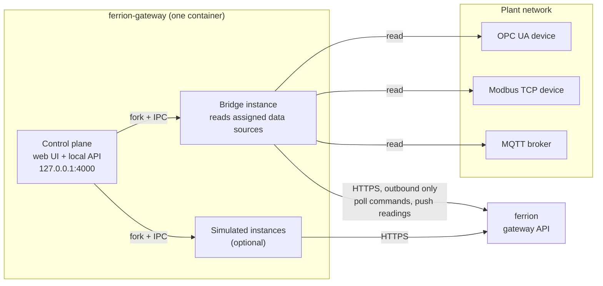

# ferrion-gateway

The on-site edge component of **ferrion**, an industrial asset platform. The
gateway sits in the plant network, reads field devices over **OPC UA**,
**Modbus TCP** and **MQTT**, and reports their measurements to a ferrion
installation through its gateway API. It can also search the plant network for
OPC UA devices on request.

The gateway never touches ferrion's database or code. It speaks one small,
documented HTTP API, authenticated with a per-gateway API key, and **only ever
connects outward**: ferrion never calls a gateway, the gateway polls. That
makes it deployable behind a plant firewall with no inbound port opened.

Licensed under the [Apache License 2.0](LICENSE). The ferrion platform itself is
a separate, commercial product.

## What it does

- **Bridges real devices.** Which devices to read, and how (address, node IDs,
  registers, topics), is configured in ferrion when a data source is added. The
  gateway picks the assignments up by itself, reads, aggregates and pushes the
  values, and buffers them through a ferrion outage.
- **Answers commands** from ferrion's "Add data source" wizard: test a
  connection, browse an OPC UA server, search the network for devices.
- **Searches for OPC UA devices** in networks the operator released, reading
  identity, firmware and the namespace array without disturbing devices
  already in use. See [device discovery](docs/device-discovery.md).
- **Simulates devices** (AVENTICS AF2 and DS1, Janitza UMG 801, Keyence FD-G)
  with real protocol servers, for development and demos without hardware.
- **Runs as one container** with a local web UI to set up the ferrion
  connection and manage simulated instances. A [Margo](https://margo.org)
  application description is included for edge orchestrators.

## Architecture at a glance



The control plane is a small local server that keeps the configuration and
starts one child process per instance. The **bridge** instance always runs and
reads every real device ferrion assigned to this gateway; **simulated
instances** each run a device simulator plus the same reader code. The full
picture, with process model, data flows and trust boundaries, is in
[docs/architecture.md](docs/architecture.md).

## Quick start

Requirements: Docker with Compose, or Node.js 22.13 or later.

1. In ferrion, open **Settings → Gateways**, create a gateway and copy its API
   key (it is shown once).
2. Start the gateway:

   ```sh
   docker compose up -d --build
   ```

   or without Docker:

   ```sh
   npm install
   npm run start:control-plane
   ```

3. Open <http://127.0.0.1:4000>. Under **ferrion connection** enter the
   ferrion base URL and the API key and save. The bridge instance starts by
   itself.
4. In ferrion, add a data source on an asset and pick this gateway. Within a
   few seconds the gateway reads the device and the asset shows live values.

If ferrion runs natively on the same host as the gateway container, use
`https://host.docker.internal:3000` as the base URL: inside the container,
`localhost` is the container itself.

The web UI follows the browser language (English or German) and has a switch
in its header.

## Documentation

| Topic | Document |
| --- | --- |
| Components, process model, data flows, directories | [docs/architecture.md](docs/architecture.md) |
| The HTTP contract with ferrion | [docs/ferrion-api.md](docs/ferrion-api.md) |
| Searching the network for OPC UA devices, and its limits | [docs/device-discovery.md](docs/device-discovery.md) |
| Fast read cycles, aggregation, reconnects, buffering | [docs/resilience.md](docs/resilience.md) |
| Memory and process cost per instance, sizing a device | [docs/resource-usage.md](docs/resource-usage.md) |
| Developing, testing, simulated devices, fleet launcher | [docs/development.md](docs/development.md) |
| Signed release images and how to verify them | [docs/releases.md](docs/releases.md) |
| Updating a running installation (German) | [docs/deployment.md](docs/deployment.md) |
| Security model, reporting a vulnerability | [SECURITY.md](SECURITY.md) |
| Penetration test 2026-09 and code review (German) | [docs/security/](docs/security/), [docs/review-2026-09.md](docs/review-2026-09.md) |
| Contributing | [CONTRIBUTING.md](CONTRIBUTING.md) |

## Configuration

Settings that belong to the machine come from the environment; everything else
is entered in the web UI and persisted in the `data/` volume.

| Variable | Default | Meaning |
| --- | --- | --- |
| `FG_CONTROL_PLANE_PORT` | `4000` | Port of the local web UI and API |
| `FG_BIND_HOST` | `127.0.0.1` | Interface the control plane and simulators bind to; `0.0.0.0` inside Docker, see `docker-compose.yml` |
| `FG_ALLOWED_HOSTS` | – | Extra host names the web UI answers to, e.g. a LAN name with `network_mode: host` |
| `FG_LOG_LEVEL` | `info` | `fatal`, `error`, `warn`, `info`, `debug`, `trace` |
| `FG_DISCOVERY_ALLOWED_CIDRS` | – | Networks the gateway may search for devices; not set means no search. See [device discovery](docs/device-discovery.md) |
| `FG_KEY_*` | – | API keys referenced by name from `fleet.config.json` (headless launcher only) |

## Security

The local web UI has **no authentication** and is reachable from the gateway
machine only; that is the trust boundary, the same as editing a configuration
file on the machine. Guards against cross-site requests and DNS rebinding keep
a web page in the same browser from crossing it. Release images are signed and
carry an SBOM. Details and how to report a vulnerability: [SECURITY.md](SECURITY.md).

## License

Apache License 2.0, see [LICENSE](LICENSE). Third-party notices for the
production dependencies are in [NOTICE](NOTICE).
