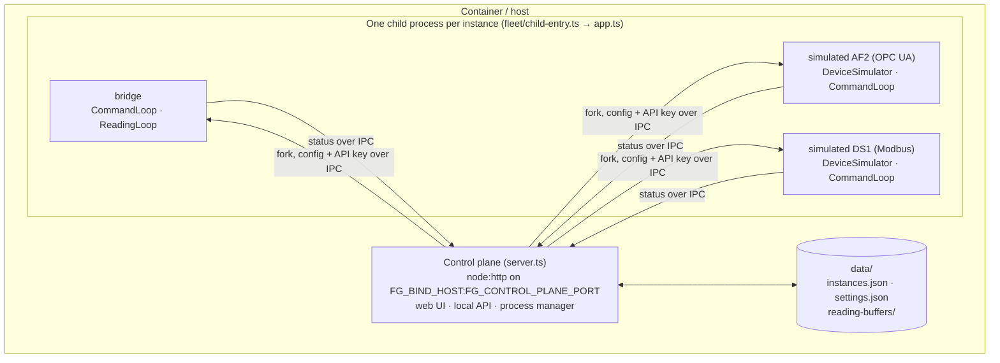
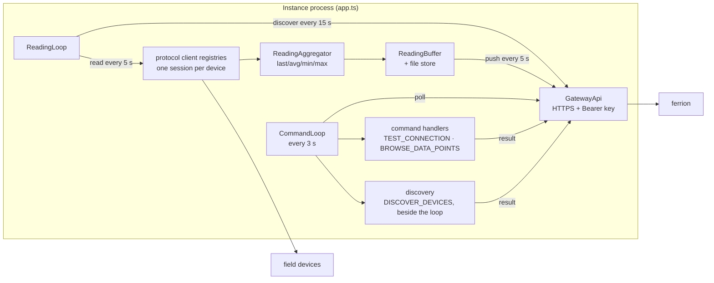
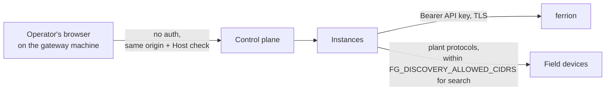

# Architecture

This document describes how ferrion-gateway is built: the processes it runs,
what each part does, how data and commands flow, where state lives, and where
the trust boundaries are. For the HTTP contract with ferrion see
[ferrion-api.md](ferrion-api.md).

## Design principles

- **Outbound only.** The gateway polls ferrion for work and pushes readings.
  ferrion never connects to a gateway, so a gateway needs no inbound port and
  can sit behind a plant firewall.
- **ferrion holds the configuration of real devices.** Which device to read,
  at which address, which node or register, lives in ferrion's data sources.
  The gateway learns its assignments from ferrion and needs no per-device
  configuration of its own.
- **Read only.** The gateway reads devices. It does not write values or call
  methods on them, and the device search opens no session at a device that is
  already being read.
- **One reader codebase for real and simulated devices.** A simulated instance
  runs a real protocol server and talks to it with the same client code that
  reads real hardware. Only the simulator itself (`src/drivers/simulated/`) is
  simulation-specific.
- **Fail visibly, recover by itself.** Lost connections are retried with a
  cooldown, readings are buffered through a ferrion outage, and every state
  shows in the web UI instead of only in a log.

## Process model

- The **control plane** (`src/control-plane/server.ts`) serves the web UI from
  `public/` and a small local API (`routes.ts`), stores the configuration, and
  starts, stops and supervises instances (`process-manager.ts`).
- Each **instance** is a forked Node process (`fleet/child-entry.ts`, which
  calls `startInstance()` in `src/app.ts`). Separate processes isolate the
  protocol libraries and their memory; one crashing instance does not take the
  others down. The configuration, including the ferrion API key, travels over
  the IPC channel, never on the command line, and a child inherits only an
  allow-listed set of environment variables.
- The **bridge** is a singleton the control plane creates on first start and
  always runs (restarted with backoff after a crash). It has no device of its
  own: it reads every data source ferrion assigned to this gateway.
- **Simulated instances** run a device simulator (real OPC UA server, Modbus
  TCP server or MQTT broker plus publisher) and answer commands. Their reading
  loop is off by default, because the bridge already reads every data source of
  the gateway, including the ones pointing at simulators.
- The **headless fleet launcher** (`fleet/launcher.ts`) starts the same child
  processes from a `fleet.config.json`, without the web UI; see
  [development.md](development.md).

## Inside an instance

**Command loop** (`src/gateway/command-loop.ts`). Polls ferrion every 3 s for
pending commands and posts a result for every one it picks up, retrying the
post with backoff. The poll carries the gateway's version, the command types it
can run, and its discovery limit, so ferrion knows what it may ask
([ferrion-api.md](ferrion-api.md)).

| Command | Handler | What it does |
| --- | --- | --- |
| `TEST_CONNECTION` | `command-handlers.ts` | Connects to a device with the values from ferrion's wizard; for OPC UA also reads the firmware version and probes fitted modules; for a Janitza UMG 801 also asks the device's web interface for its named current groups |
| `BROWSE_DATA_POINTS` | `command-handlers.ts` | Browses an OPC UA server's objects folder |
| `DISCOVER_DEVICES` | `src/discovery/` | Searches released networks for OPC UA servers; runs beside the loop so a connection test arriving meanwhile is answered at once ([device-discovery.md](device-discovery.md)) |

An unknown command type is answered as `FAILED: unsupported command`, never run
as something else.

**Reading loop** (`src/gateway/reading-loop.ts`). Every 15 s it asks ferrion
which data sources this gateway reads and starts or stops a reader per source.
Each reader reads at its interval (default 5 s, down to a millisecond); the
aggregator reduces everything read since the last push to one value per source
(`last` by default); the buffer holds values until ferrion accepts them and is
written to `data/reading-buffers/` so a restart loses nothing. Pushes go out
every 5 s in batches. Behaviour under fast cycles, outages and reconnects is in
[resilience.md](resilience.md).

**Protocol clients** (`src/protocol/{opcua,modbus,mqtt}/gateway-client.ts`).
Protocol-generic, with no device knowledge. A module-level registry shares one
connection per physical device among all its data sources: a real device often
allows only a few sessions, and one session per metric exhausted them. OPC UA
uses a subscription (the server samples and pushes changes), Modbus polls, MQTT
subscribes to topics. Each client is loaded only when an instance needs that
protocol, because `node-opcua` alone costs about 78 MiB.

**Device catalog** (`src/device-catalog/`). A read-only mirror of ferrion's
device templates (node IDs, registers, topics, namespace URIs). The simulators
use it to serve exactly what a real device serves, and the command handlers use
it to resolve a template's namespace URI and module layout.

## Data flows

**A real device, from setup to live values:**

1. A user adds a data source in ferrion and picks this gateway. ferrion's
   wizard creates a `TEST_CONNECTION` command.
2. The command loop picks it up on its next poll, connects to the device and
   posts the result; the wizard shows it.
3. The user saves. On its next discovery cycle (at most 15 s) the bridge's
   reading loop sees the new data source and starts reading it.
4. Values are aggregated, buffered and pushed; the asset in ferrion shows them.

**A device search:**

1. A user releases networks for the gateway in ferrion (Settings → Gateways)
   and starts a search in the wizard. ferrion creates `DISCOVER_DEVICES` with
   the networks, ports, a time budget and the devices it already reads.
2. Whichever instance picks the command up checks it against
   `FG_DISCOVERY_ALLOWED_CIDRS`, sweeps, identifies OPC UA servers and posts
   the candidates.
3. ferrion matches them against its catalogue and existing data sources and
   lists them; a match can be taken over into the wizard.

## State and persistence

| What | Where | Notes |
| --- | --- | --- |
| ferrion connection (base URL, API key) | `data/settings.json` | Mode `0600`; written once in the web UI, shared by all instances |
| Instances (name, template, ports, intervals) | `data/instances.json` | Validated on start; an unreadable file is set aside, not silently dropped |
| Buffered readings per instance | `data/reading-buffers/` | Survive a restart; bounded in size |
| Data source assignments | ferrion | Fetched every 15 s, never stored locally |
| Discovery limit | `FG_DISCOVERY_ALLOWED_CIDRS` | Environment only, set by the operator |

In Docker, `data/` is the named volume `ferrion-gateway-data`. Before switching
to a new version, `npm run check:data` reports whether the persisted files
still load ([deployment.md](deployment.md)).

## Trust boundaries

- **Local web UI:** no authentication, reachable from the gateway machine only
  (`127.0.0.1`, or published to loopback by Docker). State-changing requests
  must be same-origin by Fetch Metadata (`csrf-guard.ts`), and every request
  must name this machine in its `Host` header (`host-guard.ts`), which closes
  DNS rebinding. Moving the ferrion base URL to another host requires
  re-entering the API key, so a stored key cannot be redirected.
- **ferrion:** every request carries the gateway's own API key over TLS. A key
  is scoped to one gateway and its site in ferrion. Plain HTTP to a non-local
  ferrion is allowed but logged as a warning.
- **Field devices:** read only. The device search is bounded by a limit the
  operator sets on the gateway, which ferrion can only narrow
  ([device-discovery.md](device-discovery.md)).

The penetration test of 2026-09 and the code review that followed are in
[security/](security/) and [review-2026-09.md](review-2026-09.md); every finding
is fixed. How to report a vulnerability: [SECURITY.md](../SECURITY.md).

## Directory overview

| Path | Contents |
| --- | --- |
| `src/app.ts` | `startInstance()`: wires one instance together |
| `src/config/` | zod schemas and loaders for instance and fleet configuration |
| `src/control-plane/` | Web UI backend: HTTP server, routes, stores, process manager, CSRF and Host guards |
| `src/ferrion-client/` | Typed HTTP client for ferrion's gateway API |
| `src/gateway/` | Command loop and handlers, reading loop, aggregator, buffer and its file store |
| `src/discovery/` | Device search: request check, TCP sweep, OPC UA identification, LDS handling |
| `src/protocol/{opcua,modbus,mqtt}/` | Protocol-generic clients with their registries, and the protocol servers the simulators use |
| `src/protocol/*.ts` | Shared helpers: reconnect cooldown, single-flight, staleness, serial queue |
| `src/device-catalog/` | Mirror of ferrion's device templates, UMG 801 current-group lookup |
| `src/drivers/simulated/` | Simulated devices: seeded value generators bounded to real measuring ranges |
| `src/logging/` | pino logger setup |
| `fleet/` | Child process entry point, headless launcher, port allocation |
| `public/` | The web UI: plain HTML, CSS and JavaScript, no build step |
| `scripts/` | Data check before an update, NOTICE generation, release helpers |
| `Dockerfile`, `docker-compose.yml` | Container image and the development compose (builds from the working tree, publishes simulator ports) |
| `app/`, `compose/` | Margo/FLECS package for BART: application description, icon, release notes, description, licence, and the deployable compose ([margo.md](margo.md)) |
