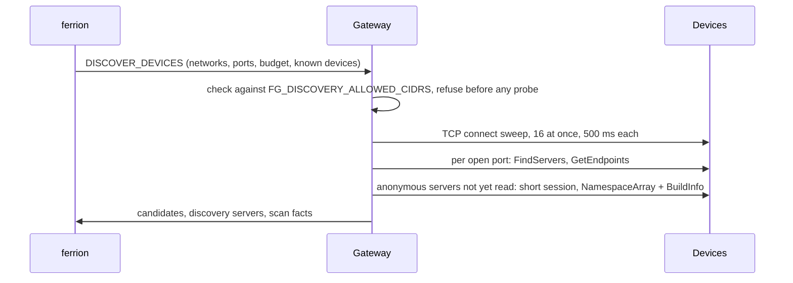

# Device discovery

On request from ferrion, the gateway searches the plant network for OPC UA
servers and reports who answers: manufacturer, product, firmware, the
namespaces a server implements, and whether it allows an anonymous connection.
ferrion matches the results against its device catalogue, so a user can take
a device over into the "Add data source" wizard instead of typing addresses and
serial numbers.

A search probes many addresses in a short time. In a company network that
reaches other sites, it could reach far beyond the plant it is meant for, and
to an intrusion detection system it looks like a port scan. Everything below is
built around keeping it narrow, gentle and under the operator's control.

## Who decides where a search may look

Two settings, both required:

1. **The limit on the gateway**, set by whoever runs it on site:

   ```sh
   FG_DISCOVERY_ALLOWED_CIDRS=10.0.4.0/24,10.0.7.12
   ```

   IPv4 networks or single addresses, separated by commas or spaces.
   **Not set means no search at all**, and that is the default. ferrion cannot
   widen this limit; it can only search inside it. Entries that are not IPv4
   networks are ignored with a warning in the log, never widened.
2. **The networks released in ferrion** for this gateway (Settings → Gateways),
   at most 8, each /22 or narrower. ferrion shows the gateway's limit next to
   them and flags a network outside it as having no effect.

The gateway reports its limit to ferrion with every poll, and the variable is
handed down to every instance process. In Docker it must be listed under
`environment:` in the compose file; after a change, `docker compose up -d`, not
`restart`. Each instance logs at start either `Device discovery allowed within
limit` with the networks, or `Device discovery disabled (no limit set)`.

Tell your IT department before the first search.

## What a search does



1. **Check.** The request must name IPv4 addresses only (never a host name,
   which could resolve anywhere), each network /22 or narrower, at most 1 024
   addresses over all networks together, at most 8 ports, and a budget of 5 to
   120 s. Every network and host must lie inside the gateway's limit. Anything
   else is refused with the reason before a single probe leaves the gateway.
2. **Sweep.** A plain TCP connect to every address and port, closed at once;
   no OPC UA byte is sent. At most 16 probes run at once, each given up after
   500 ms: at most about 32 connection attempts per second. Named hosts go
   first. The sweep gets at most 70 % of the budget; the rest is kept for
   identifying what it found.
3. **Identify.** One connection per open port, at most 4 at once:
   - `FindServers`: the server names itself; a Local Discovery Server (LDS) also
     names the servers registered with it, possibly on other ports.
   - `GetEndpoints`: application and product URI, name, security modes. No
     session is needed for this.
   - Only if the server offers an anonymous, unsecured endpoint **and** is not
     already read as a data source: one short session to read the
     `NamespaceArray` and `BuildInfo` (manufacturer, product, software version).
     A server that requires security is only flagged ("certificate required").
4. **Report** the candidates. ferrion matches them and lists them in the wizard.

### Devices already in use

ferrion sends the address of every OPC UA device it already reads, through any
gateway, as `knownEndpoints`. The search opens no session there: embedded
servers often allow only a handful of sessions, and the one the readings use
lives in another process. Such a device is identified from `GetEndpoints` and
from what ferrion already knows about it.

### Local Discovery Servers

A server registered at an LDS is added as a candidate at **the LDS's own
address** with the port it reported, because a *local* discovery server runs on
the same machine as its servers (OPC UA Part 12) and servers report themselves
by host names the gateway may not be able to resolve. A reported IPv4 address
is taken as it is, if the limit allows it; a name is never resolved. Only one
hop is followed. The LDS itself is reported separately, not as a device.

### Addresses

Servers name themselves by their own host name in every URL they report (inside
a container, the container ID). The address a data source should use is
therefore always the address that answered the probe (`endpointUrl`); the
reported one travels along as `advertisedEndpointUrl` for information.

## Result

```json
{
  "candidates": [
    {
      "protocol": "OPC_UA",
      "host": "10.0.4.23",
      "port": 4840,
      "endpointUrl": "opc.tcp://10.0.4.23:4840",
      "advertisedEndpointUrl": "opc.tcp://umg801-hall2:4840",
      "foundBy": ["sweep"],
      "applicationUri": "urn:…",
      "productUri": "…",
      "applicationName": "…",
      "applicationType": "Server",
      "securityModes": ["None", "SignAndEncrypt"],
      "anonymousWithoutSecurity": true,
      "buildInfo": { "manufacturerName": "Janitza", "productName": "UMG 801", "softwareVersion": "1.6.2", "productUri": "…" },
      "namespaceUris": ["http://opcfoundation.org/UA/", "https://opc.janitza.de/umg801/public"],
      "sessionSkipped": null,
      "sessionError": null
    }
  ],
  "discoveryServers": [{ "host": "10.0.4.5", "port": 4840, "applicationUri": "urn:…", "registeredServers": 2 }],
  "scan": { "durationMs": 21400, "probed": 254, "openPorts": 3, "notOpcua": 0, "truncated": false, "truncatedBy": null, "limit": ["10.0.4.0/24"] }
}
```

- `foundBy`: `sweep`, `host` (named in the request) and/or `lds`.
- `sessionSkipped`: `known-data-source` or `security-required` when no session
  was opened.
- `scan.truncated`/`truncatedBy`: the budget ran out (`budget`) or there were
  more than 64 candidates (`candidates`).
- Texts from a device are trimmed and cut at 256 characters; at most 64
  namespaces and 64 registered servers with 8 URLs each are passed on.

## Concurrency

The search runs beside the command loop, so a connection test that arrives
meanwhile is answered at once. A second search in the same process is refused
(`scan already running`). All instances of a gateway poll with the same key, so
another instance may pick up the next search; ferrion throttles per gateway
(one search every two minutes, three at once overall, never two gateways over
the same network at the same time).

## Not included

No mDNS / LDS-ME, no Global Discovery Server, no own certificate handling (a
server that requires security is flagged, not opened), and no Modbus TCP or
MQTT discovery yet. Reading unknown devices (PLCs, HMIs) with string node IDs
is a separate, later step.

## Code

| File | Role |
| --- | --- |
| `src/discovery/scan-request.ts` | Limit from the environment, request check, scan plan |
| `src/discovery/tcp-probe.ts` | TCP sweep and the worker pool with deadline |
| `src/discovery/opcua-identify.ts` | FindServers, GetEndpoints, session read; client certificate prepared once |
| `src/discovery/discover-devices.ts` | Sweep, identify, LDS hop, merging, limits |
| `src/discovery/handle-discover-devices.ts` | The command end to end |
| `src/gateway/command-loop.ts` | Runs the search beside the loop |
